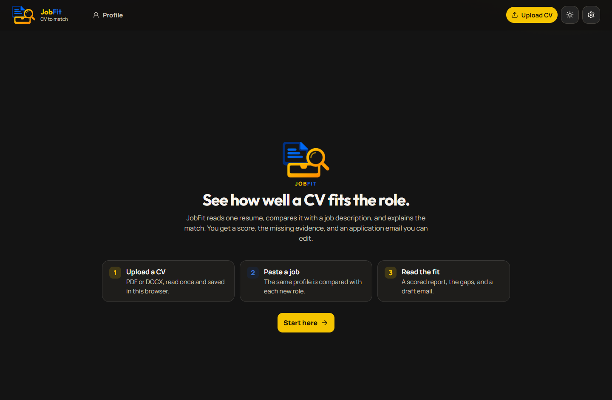
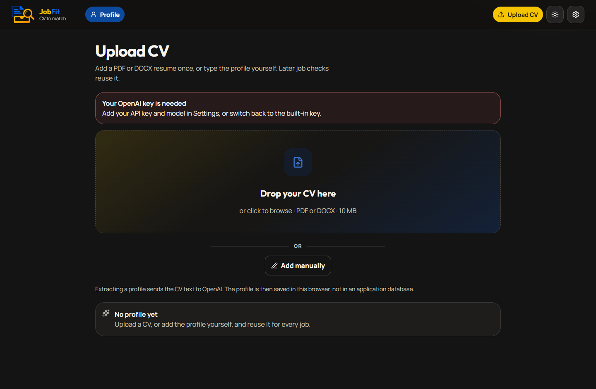
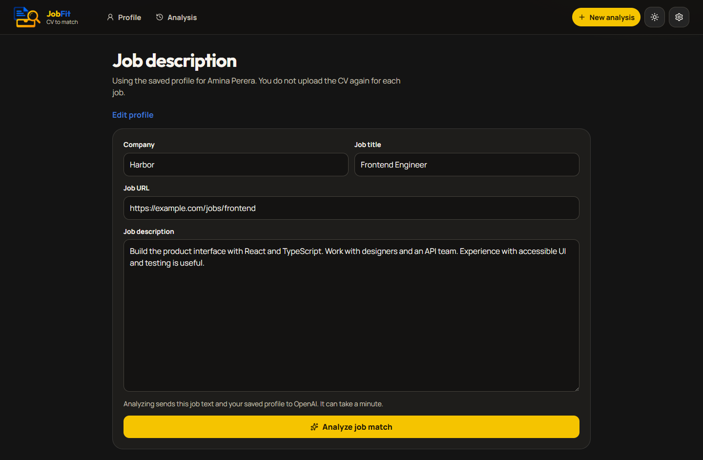
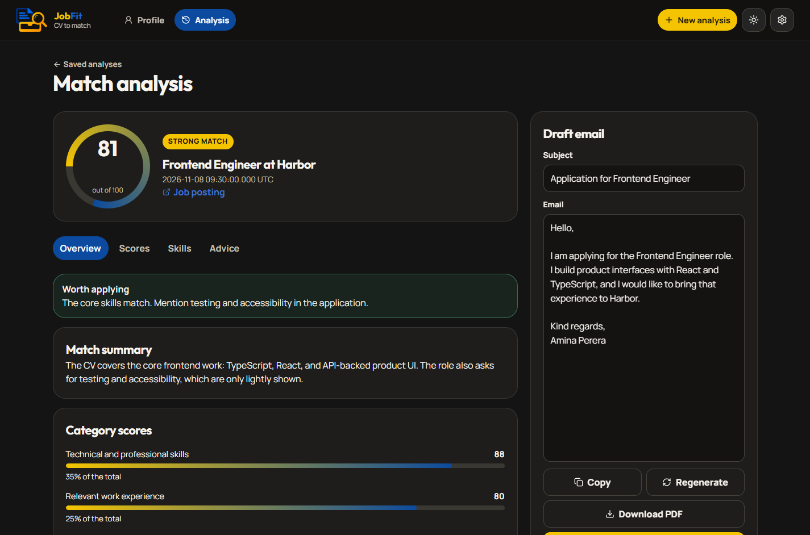
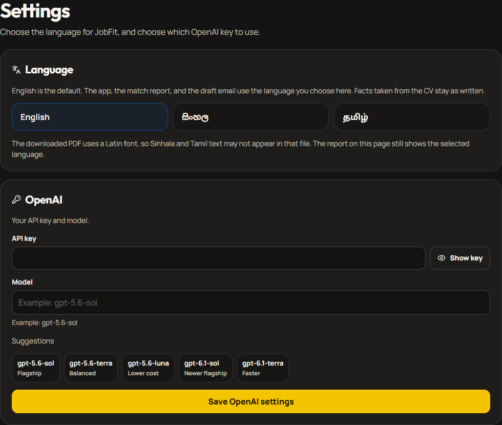
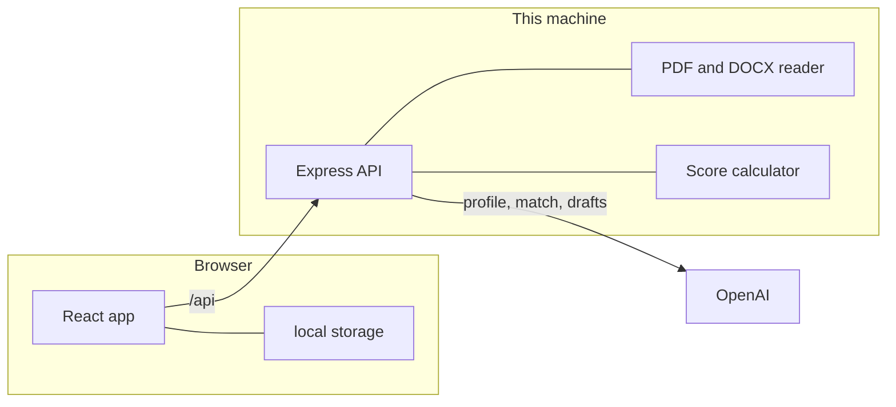

# JobFit AI

JobFit AI compares one CV with a job description. It shows a match score, the skill gaps, and three application drafts: an email, a message to the hiring manager, and a cover letter. Paste a question from an application form and JobFit writes the answer from the same profile and job. Upload a resume once, or type the profile yourself, then check other roles without uploading the CV again.

There are no accounts and no application database. The profile, job draft, and recent reports stay in this browser.

## Try it out

<p align="center">
  <a href="https://client-seven-lyart-30.vercel.app/">
    
  </a>
</p>

## Motivation

Job opportunities show up often on platforms such as LinkedIn. Working out whether a role matches your skills and experience, reading the requirements, and writing a tailored application email, a note to the hiring manager, and a cover letter is often slow and difficult.

JobFit is built to simplify that process. It compares a CV with a job description, shows how suitable the opportunity is, highlights skill gaps, and prepares those three drafts from the saved profile and the job. The aim is to make the job search easier, faster, and more efficient.



## Screenshots

The job and report screens use a sample profile so the layout is visible without a real CV.

| Upload a CV | Paste a job |
| --- | --- |
|  |  |





## What you can do

1. Drop a PDF or DOCX CV onto the page, or add the profile manually.
2. Review the extracted profile and keep it for later jobs.
3. Paste a public job link to fill the company, title, and description, or type them yourself.
4. Read a 0–100 match score, matched skills, gaps, and recommendations.
5. Switch between a draft email, a message to the hiring manager, and a cover letter. Edit, copy, regenerate, or open the selected draft.
6. Paste a question from an application form. JobFit writes the answer from the saved profile and that job.
7. Download a PDF report. It includes each draft that has text, and any application answers.
8. Choose English, Sinhala, or Tamil. English is the default.
9. Use the developer key, or save your own OpenAI API key and model in Settings.

Saved analyses stay in the settings menu and on the Analysis page. Clearing local data removes this site’s browser storage and cache, including the profile, drafts, reports, language, theme, and your own API key. The walkthrough tips show again from the home page.

## Architecture

The browser never receives the developer API key. A CV file is read on the server. A job link is read only when you choose Fill from link. OpenAI is called only for extraction, analysis, regenerating a draft, answering an application question, reading a job page that has no structured posting, and the key check. Those requests are sent with `store` set to false.



```text
client/     React, TypeScript, Vite
server/     Express, TypeScript
prompts/    Instructions for extraction, matching, drafts, application answers, and job pages
```

| Piece | Role |
| --- | --- |
| Welcome, Upload, Job, Analysis, Settings | Pages in `client/src/pages` |
| `jobfit-ai-v1` | Profile, CV filename, job draft, and up to five reports |
| `jobfit-settings-v1` | Language, and your own API key and model when you choose Own |
| `jobfit-theme-v1` | Dark or light theme |
| `POST /api/parse` | Reads a PDF or DOCX into text. Does not call OpenAI |
| `POST /api/job-link` | Reads a public job page into the company, title, and description. Calls OpenAI only when the page has no structured posting |
| `POST /api/extract` | Turns CV text into a profile |
| `POST /api/analyze` | Compares the profile with a job, then drafts the email, hiring-manager message, and cover letter |
| `POST /api/email` | Regenerates the selected draft for a saved analysis |
| `POST /api/answer` | Answers one pasted application question from the profile and the job |
| `GET /api/status` | Reports whether the developer key is present, the model name, and whether Built-in is offered |
| `POST /api/key-check` | Asks OpenAI whether the active key and model respond |
| `server/src/score.ts` | Turns the five category scores into the 0–100 result |
| `prompts/` | Text instructions sent with each OpenAI request |

Vite serves the interface at http://127.0.0.1:5173 and proxies `/api` to the API at http://127.0.0.1:8787.

### Which key is used

Settings offers two sources when `OPENAI_ALLOW_BUILTIN` is true:

- **Built-in** uses the developer key and model from `.env`.
- **Own** uses the API key and model saved in this browser.

Set `OPENAI_ALLOW_BUILTIN` to `false` when everyone must use their own key and model. The app then asks for that key on launch and explains that it is stored only on this device, in this browser.

The footer shows two tags: whether a key is configured, and whether that key and model respond.

### Languages

English, Sinhala, and Tamil are available in Settings. The interface, the match report, the three drafts, and application answers follow that choice. Facts taken from the CV stay as written. The downloaded PDF uses a Latin font, so Sinhala and Tamil may not appear in that file.

## Scoring

The model scores five categories. The server calculates the total. It does not ask the model for the final percentage.

| Criteria | Weight |
| --- | --- |
| Technical and professional skills | 35% |
| Relevant work experience | 25% |
| Responsibilities and role alignment | 20% |
| Seniority and experience level | 10% |
| Education and certifications | 10% |

| Score | Classification |
| --- | --- |
| 85–100 | Excellent match |
| 70–84 | Strong match |
| 50–69 | Partial match |
| 30–49 | Weak match |
| 0–29 | Poor match |

## Setup

Node.js 20 or newer.

```powershell
copy .env.example .env
npm install
npm run dev
```

Put `OPENAI_API_KEY` in `.env` when Built-in should be available.

```
OPENAI_API_KEY=
OPENAI_MODEL=gpt-5.6-sol
OPENAI_REASONING_EFFORT=low
OPENAI_ALLOW_BUILTIN=false
```

`OPENAI_ALLOW_BUILTIN=true` offers Built-in and Own. `false`, `0`, or `no` requires each user to save their own key and model. Changing this value needs a restart of the API.

## Deploy on Vercel

A log that runs `tsc -p tsconfig.json --noEmit && vite build` means the Vercel root directory is `client`. Leave that as it is. `client/vercel.json` installs the whole project, builds the website into `dist`, and serves the API from the same site. Deploy the commit that contains `client/vercel.json`. The imported variables are read by that API, so they apply on the new deployment.

## Security

The CV, profile, job drafts, and match reports stay in this browser. JobFit keeps no account and no application database, so that information remains on your device and out of any public or shared store. Clearing this browser’s site data removes it.

A CV is sent to OpenAI only when you extract a profile. A saved profile and a job description are sent only when you analyze a match, regenerate a draft, or answer an application question. Fill from link sends the page text to OpenAI only when that page has no structured job posting. A key check sends the active key and model so the footer can show whether they respond. Those requests are made with storage turned off.

The built-in API key remains on the server and is not returned to the browser. A key you enter in Settings is stored only on this device, in this browser. It is not placed in a public or shared store.

The server keeps a short in-memory cache of recent extractions so the same CV text is not billed twice during one run. That cache is not a database and is dropped when the API process stops.
